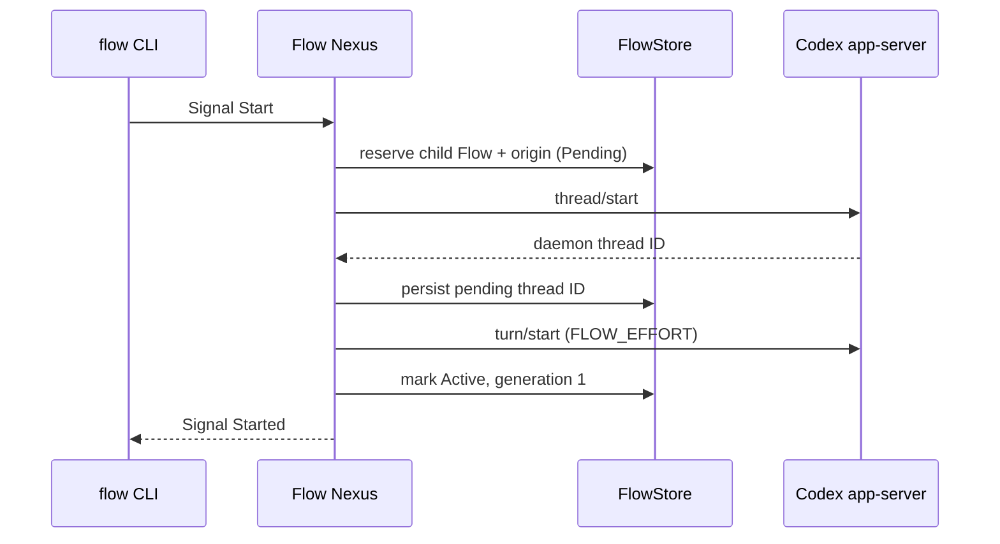

# Flow Nexus design

The ordinary and meta sockets are separate Signal edges. Text ends at a CLI:
the client turns one inline Datom into a typed request, sends an rkyv frame,
and textualizes the typed reply as Datom. The standalone `signal-flow` repo
owns `Start`, `Refresh`, `ResolveRecipient`, `Stop`, `List`,
`Replace`, `LaunchStatus`, `Observe`, and `ResolveCaller`;
`meta-signal-flow` owns `Configure`, `ConsumeReset`, the override panel at
its root, and the pane writes `TypeMessage`, `Vet`, `Command`, with
`ResolvePeer`. Each contract versions its own wire.
`RunningNexus` dispatches; `FlowStore` owns working state and policy.

What the Nexus does is its Operation root, `crates/flow-nexus/ethos/operation.ethos`,
generated by ethos-zero 16.0.0 into `src/generated/operation.rs` and held fresh by
the crate's build script. Every effect of the launch, stop, retire and record
paths (composing a launch, reserving it, each journal and lifecycle record,
registering, confirming, opening the pane, spawning and binding the harness,
titling, submitting the first prompt, closing a pane,
pruning a bundle copy) is one `Operation`, performed through `Performs` on
`RunningNexus` and answered by one `Outcome`. The dispatch paths decide; only
`perform` acts. Reads of the world (pane presence, transcript receipts, skill
catalogs) are not operations, and delivery's own lease and delivery records
are not yet.

An existing-pane queue hand-over has three steps. Under the dispatch gate,
Flow marks the selected queue prefix `InFlight` in its retained request
records. The Address lease excludes another hand-over at that Address, but the
pane writer runs without the dispatch gate. Admission can append to the queue,
hooks can record, and meta can inspect while the pane writer waits. Queue
withdrawal, request closure and queue-policy changes cannot invalidate the
claimed prefix. Under the gate again, one store commit clears the claim and
records the writer's result: Presented or Transported becomes Delivered;
Uncertain leaves the active queue without a retry; a rejection before
submission returns the request to Queued.

Both store opens settle claimed queue entries and entries still queued with an
outstanding stock attempt as Uncertain before a queue consumer can act. The
stock attempt records remain as historical evidence; a settled queue record
cannot be replayed or automatically abandoned on retirement. The existing
stored request state carries the claim; no fence or attempt table is written
for a new queue hand-over. The ordinary and meta contracts do not change.

A fresh first prompt still uses the launch protocol. The fresh queue selector
excludes claimed and final entries, and rechecks its prefix before Start.
This does not close the separate crash window after a fresh first prompt was
accepted but before its launch batch was accounted for.

Every harness event reaches Flow through the harness's hooks, which call the
socket of the place whose Nexus launched the flow through the Flow client.
The hook command Flow writes is the configuration's `HarnessHook`, the
stable path the deployment declares (CriomOS-home: `~/.local/bin/flow-hook`,
pointed at the active Flow's `flow-hook`), else the `flow-hook` beside the
Nexus, so a running flow's hook moves with the deployment. A Stop whose input does not decode,
no `background_tasks` or a task without its id, type, status and
description, is refused by `flow-hook` with a typed refusal on stderr and
exit 1, reported to nothing and never read as rest.
`flow-hook`, which Flow writes into each Claude flow's launch settings on
SessionStart, PostToolUse, UserPromptSubmit, Stop and SessionEnd, sends
`Report.{ FlowId Event }` with the `FLOW_ID` from its environment; the Nexus
performs it as `Record.Harness`, appending the event to that flow's events in
its Memory, and answers `Reported`, or `Refused.UnknownFlow` for a flow it
does not hold, which it never adopts. The owner reads a flow's events with
meta `ReadEvents`.

A Claude session /clear ends is a session change, not an exit. Its
SessionEnd, reason `clear`, reports `Cleared.Some.«session»`: Flow records
no exit and closes no pane. SessionStart reports `Started.Some.«session»`,
naming the session; the one that follows the flow's own `Cleared` rebinds
the flow to that new session, in its row and its owner proof, and its
FlowId stays. A SessionEnd with any other reason reports `Ended` and is the
flow's exit.

A Claude flow's FlowId exists before its harness. Reserve chooses the Claude
session id from the launch request id (UUIDv5-shaped, so one request names
one session), claims the FlowId for it through `flow-id`, and holds the flow
in Memory (its empty events row). Spawn types `export FLOW_ID=<FlowId>` into
the pane after unsetting the inherited identity and starts Claude with
`--session-id` set to that session, so the harness and every hook it runs
carry the FlowId from `SessionStart` on, and that first `Started` lands
before Register. Bind verifies the harness came up as that session and the
claim names that FlowId. Every Claude hook command carries the ordinary
socket this Nexus serves as typed configuration, so its reports return to
the Nexus that launched the flow. A Codex launch reserves nothing: its session is
named by its app server, and Bind claims from it as before.

A launch names the Address of its seat in its profile. The write that
journals the registration acknowledgement, once the seat's native binding is
witnessed and its flow registered and before its first prompt is typed,
records that metaflow Awake as the flow and holds it: an Address hold row
keeps the metaflow as the launch found it. Confirm makes the flow Active and
drops the hold in one write, the Address staying taken. A launch settled as
refused, or a flow recorded Stopped, Retired or Exited, while it holds its
Address gives it back in that write: a metaflow still Awake as the flow
returns to what the hold kept, keeping its queue; one the launch created is
removed, or left Asleep when requests were queued meanwhile. A seat that holds its Address is not drained at a
Stop. The taking follows Bind's rules: a metaflow Awake as a live flow, or
bound to a live process, is refused, and an absent or Asleep one, or one Awake as a flow no longer live, is taken, a displaced
flow joining Past; a replacement takes over its predecessor's. Start refuses
before launching an Address it could not take or another unsettled launch
names. A wake's fresh flow takes its Address through the same rule with
`Record.Awoken`. `Identify` names a process in a launched flow's pane, found
from the Herdr marks as ResolveCaller finds it, as the Address that flow is
Awake at, so a launched seat sends through Message; a process bound by Bind,
or descended from one, keeps naming that binding first.
`IdentifyThread` names a Codex thread's MCP send server, a child of a shared
app-server in no pane, from the thread id Codex stamped on its tool call:
Message sends the process its socket reports with that thread id, and Flow
accepts it only when the kernel reports the process running a configured
`McpSendServerBinary` under its paired `CodexAppServerBinary` (the meta
`SendServers` family). The thread names the Address of the metaflow Awake as
the one live Codex flow whose thread Flow recorded at its Start.

The launch brief and the Codex thread environment give the child its allocated
`FLOW_ID` and `FLOW_DIRECTORY`, then record the origin the Nexus derived from
the calling process: the flow bound in its pane and that flow's session, or
Unbound. Origin does not grant authority to launch. A restart is authorized
only when the calling process's derived origin is the target's registered
identity, its Flow ID and harness session. The store returns that child’s saved daemon
thread ID; the adapter resumes it; generation changes only after the resume
turn succeeds.

If `thread/start` succeeds but the first turn fails, a durable Pending record
keeps the known thread. A later child-self restart resumes it rather than
launching a second thread. A thread-start failure leaves a non-resumable
pending reservation. Both conditions recover from `FLOW_NEXUS_STORE`.

`ResolveRecipient` projects a durable Flow record into a `FlowNode`: Flow ID,
daemon session ID, harness kind, route readiness, endpoint, origin, and
lifecycle. Message Nexus consumes that typed reply instead of maintaining a
second identity registry.

`ResolveCaller` names the flow that is calling. The Nexus reads the peer
process of the ordinary connection from the kernel (`SO_PEERCRED`); nothing in
the request names the caller. Herdr's snapshot carries no process IDs, so the
pane is read where Herdr marks it: every process Herdr starts in a pane
inherits `HERDR_PANE_ID`, and in a named session also `HERDR_SESSION`, and
the Nexus reads them from the peer's `/proc/<pid>/environ`, or from its
nearest ancestor's when the peer's environment was scrubbed. Herdr's default
session exports no `HERDR_SESSION`; for a pane ID alone the Nexus walks on to
the Herdr server, the ancestor whose `/proc/<pid>/exe` is the Herdr binary,
and takes the one session whose socket in `herdr session list --json` that
server listens on, as the kernel lists its listening Unix sockets. A server
on the sockets of more than one session, a pane ID that changes on the way
up, or no Herdr server names no pane. The registry must hold exactly one routable
flow on that session and pane, and the live snapshot must still show its
binding (pane, terminal, harness); otherwise the reply is `CallerUnknown`.
The answer is the flow's role, `Caller.{ FlowId Aspect ModelName }`, kept
as its own record when MetaBindExisting binds a flow or a Start registers
one. The optional FlowId in the request is the caller's claim: a different
one is refused as `CallerMismatch`, which carries the true Caller. A binding
whose aspect is not its Address's, or whose model is not the native model
configured for its Address's Model, is refused `RoleMismatch`. A
MetaBindExisting of a flow already held records its role only when the stored
flow is that binding (thread, harness, Herdr session, pane and terminal) and
has no other role; it writes nothing else, and any other binding is refused as
`DuplicateFlowId`. The Codex endpoint of an imported flow is a separate fact,
never a gate: routing and promotion follow the Herdr route. `ResolvePeer`
on the meta socket answers the same question for a process Message names.

Flow is the only pane writer. `TypeMessage`, `Command` and the work handed to a
woken seat act only on a route that still matches the native Herdr
snapshot, and each holds the pane's lease (`delivery::lease`) from its first
key to its last. A route is keyed on what Herdr binds for the pane's life:
session, pane id and terminal id, with the harness kind. The agent name is a
label a running flow may change; it is re-read from the snapshot and
reported, never matched. `TypeMessage` renders the typed Message (its Priority
head first), refuses a body carrying a control character or a harness command
(`delivery::body`), and refuses a Blocked recipient and an occupied composer.
A `Soft` request is handed to it only at its recipient's idle event, the
seat's Stop or its Codex thread's turn completed; until then it waits in its
metaflow's queue (`waking::HoldsSoftForIdle`). Only a waking request (an
Order, a Question, a Task, the living's words, a Result or a Done) starts
the seat's next turn: a queue of Soft Notices alone is not handed over, and
they ride with the next hand-over. `HardAbrupt` and `MiddleAbrupt`, a Notice
among them, are handed over when they arrive. `HardAbrupt` presses the
profile's interrupt keys when the recipient is Working and records whether it
was seen leaving Working; the composer is read before any key, so a draft
refuses it without cancelling the recipient's turn, and a prompt the
interrupt returns to the blank composer is that turn's own and is submitted
again before the letter. Grades are exact: `NotDelivered` (nothing typed),
`Transported` (Herdr took the text for the exact binding), `Presented` (a
settled agent observed reacting on the exact pane, the route still matching
afterward) and `Uncertain` (typed, reaction unobserved). Each step is written
to a `PaneLease` row; a row found when the store opens settles `Uncertain`
and is never retried, and `TypeMessage` repeats answer the stored `Delivery`. A
Pending row is promoted only by a Presented TypeMessage; no probe or marker is
ever typed to promote it. `Command.Compact` is an emergency measure: before
the lease is taken it is refused `CompactionRefused` unless the flow's last
measured context (`flow_nexus_flow_context_sizes`) reached the refresh
threshold of its model, the model its role records, else the one its launch
named. A `TypeMessage` into a flow at or past that threshold is refused
`PastThreshold`. Stop changes the durable lifecycle only after the
exact pane closes successfully, and closes under the lease. `List` reads the
same store rows and sorts them by Flow ID.

Every query on either socket gives the same answer to every caller: a flow,
a subflow, or the living at a shell. The calling process is read for one
thing, the sender a message is filled in with (`sending::IdentifiesSender`,
`caller::AuthenticatesProcessAuthority`): the metaflow its pane's bound flow
or its Codex thread names, or `Unbound` for a caller in no flow, which is
served (`SentBy.Unbound`, shown `VisibleSender.Unbound`). A Launch records
its caller as its origin; nothing else reads the caller. There is no meta
gate (`MetaAspects` and `MessageNexusBinary` are configured and read by
nothing), no protected-address guard (a protected Address is only never
refreshed for its context), no self-restart refusal, and no owner check on
`MetaBindExisting`. `Send`, `DeliverAll`, `ObserveSends` (every send, whoever
sent it), `ArchiveRequest`, `Keep` and `Drop` (the Address's Awake flow's
handover), and the Message bridge (`Bind` of the named process, `Identify`,
`IdentifyThread`, `Lock`, `Deliver`, `Release`, `Acknowledge`,
`ObserveSender`, `ObserveDeliveries`) take any caller. `BindSeat.{ Address
SeatPane }` and `Adopt.{ Address SeatPane NativeSessionId }` bind the seat
in the pane they name. A Result or a Done closes the open request it names
whoever sends it, and the Nexus routes it to the sender of that request,
whatever Address the Send writes (`store::kept_answer::RoutesAnswers`); a
request whose sender is no Address (Unbound, Flow, Unknown) keeps its
answer, which closes it, the Send answered `Sent` with the request's id,
and `Answer.RequestId` reads it (`Answered` with its sender and priority,
or `AnswerRejected.[ UnknownRequest Open Routed StoreRefused ]`). A Codex
thread's send tool routes its Results the same way, answering `Kept` for a
kept one. A hook's Report is answered `Reported` whoever sends it, and names
the birth of the harness that ran the hook (`Report.{ FlowId Option<Process>
Event }`, found by the hook above itself: the nearest process whose command
line names the event's session after `--session-id` or `--resume`, or whose
Claude session record names it). A seat a restart bound shares its native
session with the harness it replaced, so its events act only when they name
its own harness's birth; the caller is not read. Every launch, a Start, a
Replace, a Launch, a wake, a successor and a restart's resume, opens its pane
in the one Herdr session `Configure.Nexus` names (`launching::
NamesLaunchSession`). A refusal names the state of the thing asked about. Both
sockets are `0600` under one UID; security is the host's.

A request, a reminder and a queue each have an operation of their own on the
ordinary socket (`queue_operations`): `Cancel.RequestId` withdraws a request
still queued and archives it with its id and a Task's reminder.
`Cancelled.RequestId` answers the caller. A distinct receiver of reached
work, including an Uncertain delivery, gets a Soft Notice. Queued
withdrawal is silent; only a Question and a Task take an answer (`TakesAnswer`), so any other
request that reached its recipient is finished and Cancel and CloseRequest
naming it are refused `Closed`;
`CloseRequest.RequestId` closes an open request with no answer as Cancel
ends it, answered `RequestClosed.RequestId`, and tells no one: no Notice is
queued, so a done request leaves the open requests every successor of its
recipient is given without anyone being woken. Cancel and CloseRequest share
one ending (`queue_operations::EndsRequests`), told apart by their
`store::closed_request::RequestEnding`: Cancel can notify the reached receiver,
and CloseRequest records the process the caller's connection
showed, `ClosedRequest.{ LogicalDeliveryId RequestId Closer.Option<Process> }`
keyed by the logical delivery (a request id is drawn again once archived),
in the commit that archives it; whoever asks is served, as for a Cancel;
`Silence.RequestId` closes a Task's reminder and leaves the Task open; a
Task's sender is reminded once, when its minutes pass (`TASK_REMINDERS`),
by a Soft `Reminder.{ RequestId String }` from Flow that names the task by
its RequestId with one short line, `The task to Field core Sol has no Done
after 10 minutes.`, never the task's own text, queued marked Queue so a
sleeping sender reads it at its next waking and is not woken for it, and is
told nothing more;
`Clear.Address` and `ClearAll` withdraw everything queued, answering the ids;
`Push.{ Address Priority }` delivers the whole queue of an Awake seat now as
one Waking at the priority named (the waking lease carries it,
`waking::PushesAtPriority`), and wakes an Asleep metaflow when its queue holds
a request whose kind wakes it (`request_waking`); `Queues` reads every
queue that holds something, each message as it would land in the prompt,
its sender and priority with it; `Hot` reads every live flow's Address with the
minutes since its last turn ended, from a per-Address turn end kept beside
each harness's (`store::turn_end`). `RequestRejection.[ UnknownRequest NotYet
Closed NotTask StoreRefused ]` names why a Cancel, a CloseRequest
(`CloseRequestRejected`) or a Silence changed nothing.
`Remind.{ Address Minutes String }` keeps a reminder for the Address it
names (`store::scheduled_reminder`), answered `Reminded.RequestId`, its
request bound open; when its minutes lapse the Address is sent
`MiddleAbrupt.Reminder.{ RequestId String }` from whoever asked
(`reminding`), marked Wake so a sleeping Address is woken for it, and the
request closes. Its Minutes meets a Task's rule;
`Cancel` and `CloseRequest` end a pending reminder without sending a prompt.

On the meta socket one declaration is changed alone:
`Configure.Permaflow.ConfigureMetaflow` (keyed by its Address),
`Configure.Harness.HarnessProfile` (by its harness, within the declared
Nexus) and `Configure.Refresh.ConfigureThreshold` (by its model name) add or
replace one row in one atomic commit, the rest of its family kept;
`Remove.[ Permaflow.Address Harness.HarnessKind Refresh.ModelName ]` takes
one away. A Configure answers `Configured` with the change it was given,
a Remove `Removed` with its Removal, each echoed whole whether or not
anything was written; a Harness while no Nexus is declared answers
`Unconfigured`, and a refusal `ConfigureRefused`. The family-whole `Configure` stays.

`Replace` carries a `StartRequest` whose profile names the predecessor. The
successor launches through the one Start path. From the successor's
confirmation its Address receives as it: the metaflow row with its
AddressHold is the one record that names the receiving flow, and the
confirmation is the one commit that switches it. Until the confirmation the
hold makes the predecessor receiving and the successor `Unconfirmed`; from it
the predecessor is `Superseded` and `Vet`, `TypeMessage` and `Command` refuse it
so (`Superseded.<successor>`), `ResolveRecipient` answers `FlowUnavailable`.
No obligation, outcome or lifecycle decides routing, so no later write can
hold a confirmed successor out of it.

The reap is then owed in one commit, W3: the predecessor recorded `Stopped`,
the outcome `ReapPending`, and a PendingReap row at `Owed`; the Replace answers
`ReapPending.{ <Address> <Predecessor> <Launched> Owed }` at once, before any
Herdr call. The reap's Herdr steps run outside the dispatch gate, in its
worker (`reaping`): one per PendingReap whose pane step is owed, armed by a
supervisor woken only by launch changes. The worker subscribes to Herdr's
`pane.closed`/`pane.exited` first, then reads the predecessor's pane, closes
it once while it is still the predecessor's, and waits for Herdr to show it
gone. Then, under the gate, it revalidates (its cancellation, the row, its
launch and who owes it, the predecessor's route) and settles: the Address's
receiving flow, read afresh, decides the handover, closed for the successor
only while the Address still receives as it; the outcome becomes `Replaced`
and the row goes. A stale worker writes nothing; no worker write is a routing
write. A route that is not recorded settles nothing by itself, only
independent evidence (the predecessor's row `Retired` or `Exited`) does.

One close rule serves every reap worker: the predecessor's recorded pane is
closed only when a fresh read shows it `Owned` (its harness reports the
recorded session, or, a Codex TUI reporting none, a foreground process of
the pane runs `resume <recorded thread>`) or `Bare` (the recorded pane and
terminal with no agent). `Foreign`, `Unproven` and `Unidentified` are never
closed and not counted gone; the worker waits for Herdr's own Gone. `Absent`
settles, and only from a snapshot that carries both its agent roster and its
pane list; a snapshot without its pane list is `Unknown`, which closes and
settles nothing. Two boundaries are taken knowingly, in every close Flow
makes. The snapshot-to-close race: the pane can change between the read and
the close, and Herdr has no compare-and-close, so the close is made on the
read's evidence. The Bare-shell boundary: a `Bare` pane at the predecessor's
own terminal is closed even when a person works in its plain shell, because a
harness that exits leaves its pane `Bare` and Herdr announces no going for it.

Who owes a reap is recorded on its row (`ReapResponsibility`): the successor
its launch's outcome names (`LaunchSuccessor`), a later flow that took it over
(`TakenOver`), or the Address itself when nothing receives there
(`AddressHeld`). W3 chooses it from the Address's current succession in the
commit that writes the row: a derived reap written after its successor ended
is born owed by the flow the Address receives as, or by the Address, never by
that successor, which stays only the history its outcome records. It follows the Address's receiving flow: every commit
that changes which flow the Address receives as carries the reassignment of
the reaps there, under the dispatch gate. The successor's end (`Stop`,
`Retire`, an `Exited` recorded by a delivery, a wake, a refresh or an
observation) puts the Address to sleep and gives what the ended flow owed to
the Address; the settlement of a launch that made another flow the receiving
one (W3, `StartedHandedOver`, `HandoverOwed`) gives it to that flow, but only
while the Address, read in that commit, receives as it; an adoption, a Bind,
a rebind, a wake's `Awoken`, a `Record.Asleep` and the forgetting of an ended
binding do the same. A row whose pane was already witnessed gone is finished
in that commit from the closure its standing records (`Replaced`, no
generation, no Herdr call); a row whose pane step is owed is taken over, and
its worker, cancelled as reassigned (or, revalidating first, stale), is
followed by one worker under the new owner; a row standing as typed state is
untouched. A row whose `LaunchSuccessor` names no `ReapPending` outcome has a
Missing owner, never the Address: nothing moves or settles it. A pending
reap is taken up by its owner's bearing events: its rest (which calls no
Herdr), the end of the owner, the worker's own Herdr events, and the Nexus
start for what the Address holds, which settles a store-only row and reads an
unknown predecessor once, with no Herdr call and no retry. A retried `Stop`
whose recorded pane is positively `Absent` records `Stopped` with no close, so
an end whose commit was refused is run again; a route not recorded, or a
snapshot that proves nothing, answers `RouteUnavailable` as before. A refused
close, an unread Herdr or a refused settlement leaves the reap at its typed
`ReapStanding`; `Inspect` lists it. A missing predecessor stands as
`PredecessorMissing` and no event retries it.

A fresh launch settles its Address's handover in its own commit:
`StartedHandedOver` when the handover row's owner has ended or nothing moves,
else `HandoverOwed`, a PendingHandover at its refusal and the answer
`HandoverPending`. Its next rest, its own `Keep` or `Drop`, and the next start
take it up. Every settlement of a launch that made its flow the receiving one
supersedes the obligations it takes over at the Address: an earlier
PendingHandover becomes `HandoverSuperseded`, and the reaps there are taken
over as above. The supersession is the current receiver's alone: it reads
the Address in its own commit, and a settlement whose flow no longer
receives there (a derived W3 written after its successor ended) supersedes
nothing, so the receiving flow's own PendingHandover and outcome stand. A
receiver that cannot be read refuses the commit. An owner that no flow row names stands as
`Owner.Missing` until a repair act is designed.

Every launch request settles into one stored outcome — `Started`, `Replaced`,
`StartRejected`, `ReplaceRejected`, `ReapPending`, `HandoverPending` or
`HandoverSuperseded` — once an attempt was reserved for it.
`LaunchStatus` answers a known request with one `LaunchInspected`: its durable
attempt, optional settled outcome, and current recorded `FlowNode` or explicit
absence. A request with neither attempt nor outcome is unknown; an outcome
without its attempt or a binding that disagrees with the outcome is
`InconsistentRecords`. The reads compare each database marker and recheck the
current marker; a changed view is `ReadViewChanged`. This is a checked
multi-read, not a storage transaction. A duplicate `Start` may still answer
`LaunchPending` while the original launch runs. `Observe.Launch` keeps its
connection as the subscription: the current inspection on open, one
`LaunchInspected` frame per phase change, and the settled inspection last,
then the Nexus closes the exchange. Phase changes are announced by the store; a launch
waiting on its first prompt is moved by a file-change watch on its native
transcript root, which promotes it under the dispatch gate. The Nexus holds
that watch itself for every ambiguous launch, from startup on, so a receipt
that lands after `StartAmbiguous` promotes with no subscriber and no second
Start. Nothing re-reads on a timer.

A plain `Start` does not answer the caller with that ambiguity while the
launch is in fact settling: having submitted the first prompt it releases the
dispatch gate and waits for the launch's outcome, which the same watch
produces, and answers it. `StartAmbiguous` is what a seat that never answers
at all comes to, once the wait's bound has passed.

A metaflow's declaration (`ConfigureMetaflow`) names, beside its modules,
its `Continuity`, its `Purpose` and the `Records` of the living it rests
on. Its purpose is composed ahead of the brief of a Launch, a wake and a
successor. Its records are stored but not yet composed: Curriculum's
`StartupSelection` names flows, not record paths.

A launch names its `Remembering`: `Predecessors.<depth>` or
`Custom.[ FlowId … ]`. At Compose, Flow resolves it to flow ids, the
metaflow's lineage (its past then the flow it is Awake as, the launch's own
bound flow never among them) to the depth, oldest first, or the flows named,
and asks Curriculum to compose those flows' raw vision and notion records
(`StartupSelection` names them; `StartupComposition` carries `RecordsText`
and its digest, which Flow verifies). The records follow the USER modules in
the first message, ahead of the brief. A wake, a refresh and an exit's
successor remember their predecessor, `Predecessors.1`.

A module is placed by its kind, whichever list of the launch names it:
spirit and intent (`spirit:…`, `intent:…`, or a legacy name before its
first hyphen) in the system prompt, every other kind in the first message
with the remembered flows' records. An identity is `type:subject` or a
hyphenated name not yet in that form.

A start is one model call. Every module the launch names is in the system
prompt or the first USER message, and the first USER message is sent once:
when the USER modules and the brief do not fit one message (Herdr's 1 MiB
request line for Claude, the app-server's 1 << 20 characters for Codex), it
is sent in as many parts as it takes, one right after another, each part
headed with its number; no USER module ever joins the system prompt, which
holds spirit and intent alone. A simplified flow keeps all its modules in
its own system prompt. The system prompt travels in no argument:
Claude reads it from the Nexus's in-memory file and a Codex thread is given
it as its base instructions. A brief that alone does not fit refuses.

A seat knows its own FlowId before its first model call. A Claude launch's
FlowId is claimed at Reserve, before the harness exists, and its launch
section opens with `Flow: <id>`. A Codex launch's FlowId is claimed at Bind,
from the thread Codex named, after the thread holds its base instructions;
the seat is given `Flow: <id>` as one developer item in its history before
its first turn. The first USER message is the same for both.

The first prompt is the brief, and the seat's first answer performs it. The
brief ends asking for a presentation, as does queued work that carries the
living's words; a message from another flow carries no such line. A
successor of a refresh or a waking is given its predecessor's handover,
whole, after the brief, read through one source (`handover::YieldsHandover`)
the composer holds: the sections the predecessor kept in Memory, or, when
it kept none, its `flows/<FlowId>/handover.md` under the launch root. After the handover, last, it is given the requests its permaflow
still owes an answer: each Order, Question or Task a sender's delivery
reached any flow of the Address, its id not yet closed by a Result or Done,
oldest first, as one vector datom in the form it was delivered in, under
the id it was delivered with (`HoldsOpenRequests` in Memory), directly after
one line naming the predecessor that left them open
(`handover::FramesOpenRequests`); nothing open places neither. A Result or
Done is admitted from any flow of the Address the request was delivered
to, so the successor answers by the same id. A Restart has no first
prompt and is given none. The
receipt is what the native transcript of the bound
session shows: the first turn authenticated by its body digest, every selected
skill loaded in order, and, for Claude, the seat's first answer after them at
the intended model and effort. Codex records its turn's model and effort
before its input, so its confirmed skill loads are the receipt. No caller and
no human follows a launch.

`List` answers the reconciled truth, not the stored row alone: a live flow's
bound pane is looked for in Herdr, and finding it present reports the flow
Active with a refreshed route, while finding it gone reports it `Exited`, with
no route. A Herdr that cannot be read changes nothing.

Reading that truth and recording it are separate. `List` writes nothing,
because a query does not change what it is asked about; an ended lifecycle is
persisted only by a command that witnesses a pane's fate — `Stop` and a
replacement's reap record `Stopped`, a `TypeMessage` whose bound pane is gone records
`Exited`, and `Close` on the meta socket records `Retired`.

Each ended state names who ended the flow, and they do not stand in for one
another. `Stopped` is Flow's own act on a pane it held. `Exited` is the seat's
own going, or its accident. `Retired` is an owner's act, and only authority
produces it: a pane going away never retires a flow, because an exit retains
the flow's record and retirement is a decision, not an inference. None of the
three deletes anything.

No pane outlives its flow. In the event that ends a flow — `Stop`, `Retire`,
a refresh, a sleep, a replacement's reap, an exit — Flow closes the flow's
harness and its Herdr pane where they are still there: a pane showing the
flow's own session, or no agent at all. A pane already gone is nothing to
close, and a pane now running another session is never closed. `Stop`,
`Retire` and a refresh close under the pane's lease; an exit is recorded
where a write may already hold the lease, and closes without it. A close
Herdr refuses holds back a `Stop`, a refresh or a `Retire` (`CloseRefused`),
which records nothing, never an exit, which is recorded all the same and
the refused close logged.

Every Codex thread Flow opens declares one dynamic tool, `send`, whose
arguments are a target Address, a kind (`Order`, `Question`, `Result`,
`Notice`) and a body. The living's words are not among the kinds of the send
tool. The app-server accepts a
thread's dynamic tools only on a connection initialized with its experimental
API. Before Flow opens such a connection it probes the deployed app-server: on
a connection initialized without it, a `thread/start` declaring the tool must
be refused for exactly that reason (codex 0.161.0-alpha.2 answers -32600,
"thread/start.dynamicTools requires experimentalApi capability") before any
thread exists. Any other answer is `SendToolUnsupported`; a thread the probe
started is archived at once on the same connection. The launch is refused
at its Codex thread stage (`NativeLaunchRefused.{ CodexThread
SendToolUnsupported }`) rather than started without the tool.

The app-server sends each call as an `item/tool/call` server request to every
connection subscribed to the thread, and takes the first answer. A call left
pending while no answer came is replayed to the next connection that resumes
the thread. The Nexus keeps one connection per live Codex thread it holds,
subscribed by `thread/resume` (without its turns) when the Nexus starts, when
the store announces a change that brings the thread's flow, and after every
reconnect: at once when a connection closes, and on the app-server's socket
appearing at its name (an inotify event watched before each attempt) when an
attempt fails. That connection starts no turn and carries no model content, and it
is the one intended responder. First answer wins is how the app-server
behaves, not a security guarantee: any process of the same user that resumes
the thread can answer a call first.

A launch's first turn can call the tool before its flow exists. Herdr's
`agent start` returns only once the agent is idle or done and interactively
ready, and a turn waiting on a call is neither. So a Codex launch, after
`thread/start` and before `turn/start`, records the thread as its own
(`flow_nexus_launch_opened_threads`); no first turn is started when that
fails, and the thread is archived. The connection that started the thread is
subscribed to its server requests from then on (a `thread/resume` of a
thread with no turn yet is refused, "no rollout found"), so it is kept open
as the launch's responder. While the launch waits for Herdr's start and for
the bind's rest wait, holding the dispatch gate, it reads that connection and
answers each call as the gate's holder. The connection is closed when the launch ends,
whatever it came to; a later call is the Nexus's responders'. Targets the
launch's calls queued work for are woken once the gate is given back.

A Codex launch a Nexus left between opening its thread and acknowledging its
seat is never finished, and its registration would wait on a seat that a
pending call keeps from resting. Before serving anything, the Nexus takes
each unsettled Codex launch whose thread is recorded and whose phase is
NativeLaunchIntentRecorded or NativeBound. Its outcome and its cleanup are
apart: the Nexus first records the launch's cleanup, a thread step and a
pane step both Pending, then settles the launch
`NativeLaunchRefused.{ Spawn Unclassified }`. The thread step resumes the
thread, resumes it again as the replay's end (the app-server answers a
resume of a running thread only after the replay of the one before), and
answers each call replayed before that end: one the earlier Nexus committed is
answered from its record and queues nothing more, any other is refused
`ThreadUnowned` and queues nothing; then it archives the thread, and is Done
only once the archive succeeded. The pane step takes down its pane and any
flow it registered, and is Done only once nothing of it is left running. A
step still Pending is taken again at every start, the launch already
settled.

A pane is closed only when Herdr shows it the Flow's own: the agent at the
recorded pane and terminal, of the recorded harness, reports the recorded
native session, or, a Codex agent reporting none, one of the pane's
foreground processes runs `resume <thread>` for the recorded thread; or the
pane shows no agent at all. A pane running another session, a session
nothing proves, or a Flow with no recorded session closes nothing, and a
launch's pane left so stays recorded for the next reconciliation.

A call is handled under the dispatch gate. Its sender is read from Flow's
records each time it is handled, a replayed call included: the one live flow
Flow holds on the calling thread, and the metaflow Awake as it; failing that,
while the Codex launch that opened the thread is unsettled and no other flow
or launch holds its Address, that launch's Address. A thread no flow of
Flow's runs and no unsettled launch opened is `ThreadUnowned`, a Stopped, Retired or Exited flow is
`FlowEnded`, and a flow whose metaflow is no longer Awake as it (Asleep, or
moved on by a wake's fresh flow) is `NotAwake`; none is recorded. The
request is queued for the target, with that sender, under the rules a Lock and a Deliver follow
(an absent target is `UnknownRecipient`, one Message holds an unexpired lock
on is `Held`), and the call is
recorded with its outcome in the commit that queues it, in
`flow_nexus_send_calls`, keyed by thread, turn and call id with the digest of
its tool and arguments. A call whose key is recorded with the same digest is
answered from its record and queued nothing more; with another digest it is
`KeyReused`. The answer is one `inputText` item holding the outcome as a
datom, `Queued.{ Sender Target }` or `Refused.SendRefusal`, with `success`
true only when queued.

A metaflow continues as its declaration's `Continuity.[ OnDemand
Maintained ]` names; a metaflow no declaration names is OnDemand. A wake
composes its fresh flow from the metaflow's declaration alone: an Address
no declaration names is never woken (`WakePlan::Unplaceable`), whatever
its last flow's launch named. A
metaflow is Maintained by its exact Address, never by its Model. When a seat's turn ends
and it rests with nothing queued, an OnDemand seat sleeps: its harness and
pane are closed under the pane's lease (a Claude seat only once it rests,
so background work is not ended) and its flow recorded
Stopped, its metaflow Asleep, its Address and the flow's transcript kept.
A Maintained seat stays Awake in its pane.
A metaflow is Asleep once its flow has ended: slept, its pane closed by the
living, crashed, or replaced.

A Maintained metaflow always has a flow. When its flow is refreshed, or
ends unexpectedly (recorded Exited when its Claude hook reports its own
session's end, `Report.{ FlowId Ended.Some.«session» }` on SessionEnd, or,
as the fallback, by a Deliver, a drain or an Observe that witnesses the
pane absent), Flow records a successor intent
(`flow_nexus_successor_intents`, one per Address), the exit's in the same
write as the Exited record, and starts the successor with no queued request
needed. The intent is given in the write in which a flow takes the Address:
a wake's Awoken record, or the confirmation of a launch. A Stop or a Retire
is an act, not an exit, and owes nothing. At its start the Nexus takes up
every intent: a predecessor still Awake is refreshed again, under the
launch request the intent names; an Asleep metaflow is woken; an intent a
flow already took the Address for is forgotten.

Every lock a metaflow holds as a sender is retracted in the write that ends
its flow, Stopped, Exited or Retired, so a recipient is never held by a
sender that has ended.
Whether a target wakes is read from Flow's records, never carried with the
answer. A metaflow of any Model is due a wake when it is Asleep and holds a
request whose kind wakes it, whatever its priority (`request_waking`): an
Order, a Question, a Task, the living's words, a Result or a Done. A Notice
waits in the queue for the next waking, and a Reminder wakes by the mark it
was queued with: Wake when a flow asked for it with Remind, Queue when it
reminds a Task's sender. The owner's
`Deliver`, the hand override, marks every queued entry Wake, so the metaflow
it names is woken whatever its queue holds. A `Push` adds no mark: it wakes
an Asleep metaflow by the kinds its queue holds, so a queue of Notices alone
stays asleep under it. A Send or a locked Deliver to a recipient
with no live flow starts it before answering only for an abrupt request that
wakes it; an abrupt Notice is queued for the next waking, and a Soft request
that wakes it is answered queued and woken after its answer. To an Awake
seat the priority and the kind decide, as above. After every commit that queues a
request, from a send-tool call or a Deliver, and after a replayed call is answered from its record, the
target's Awake seat is read first: a seat whose pane Herdr shows gone has
its flow recorded Exited, which puts the metaflow Asleep, and a seat known
resting (a Claude transcript whose main turn ended with no later prompt, a
Codex thread its app-server shows resting) is handed the oldest request in
its live pane at once. Then the
target is held against a second wake, read again under the dispatch gate,
and woken when due; this runs whether or not the answer reached the caller.
At its start the Nexus wakes every metaflow due a wake, so a Nexus that died
between the commit and the wake leaves none owed. A wake already running for
the metaflow absorbs the request: it drains what arrives during it.

A hand-over takes the queue's head, the whole queue up to the first
request still waiting for its admission reply (a Simplified seat's oldest
alone), types it in one payload under the dispatch gate and the pane's
lease, and records the pane writer's own result in the one store commit
that takes those requests from the queue (`logical_delivery::
record_hand_over`): Presented or Transported is Delivered, naming the
seat's session and the pane write; Uncertain is Uncertain, final and never
looked for again; a write refused before any key leaves them queued for
the next due event. Nothing is read back from native history.
No migration runs on the delivery path: queue data from before logical
identities is archived once, when the store opens, before anything is
served (`archive_legacy_queue`).

A wake's fresh flow takes the queued batch in its first prompt. Its launch
answers `Started` once that prompt is submitted: that is the writer's
result for the batch, and every request it carried is Delivered in the
commit that takes the batch from the queue and records the woken flow
Awake. A direct Send that woke its recipient answers `Sent` from it; one
whose request stays queued behind the batch waits for the seat's next due
event.

A Codex seat runs no hook and reports no Stop; its turn ends are its
app-server's. Every connection Flow keeps on a Codex thread (the launch's
opening connection, then the Nexus's responder) reads that thread's
`turn/started`, `turn/completed` and `thread/status/changed`, and the
`thread/resume` that subscribes a responder answers the thread's status as
the app-server holds it then. From these alone Flow holds whether the
thread is in a turn, holds work Flow typed whose turn has not begun, or
rests; a thread with no such evidence never rests. A turn's completion is
counted once by its id, an idle status does not end a named turn or typed
work, and the resumed status covers a completion that came while no
responder was subscribed. When a confirmed seat's thread comes to rest, or
work is queued for a seat whose thread rests, the seat is settled as a Stop
settles a Claude seat: under the dispatch gate the oldest queued request is
handed to its thread, sender first, and the thread then holds that work
until a turn that began after it completes; with nothing queued the seat
sleeps or stays Awake as its metaflow's Continuity names. A HardAbrupt
typed after Flow pressed the interrupt keys into a working seat cut short
the turn the thread was in, and the letter starts the next turn: the cut
turn's completion is its late end and rests nothing, and the turn the
delivery started is the one whose completion rests the seat. The cut turn
is the one the thread's events showed it in when the keys were pressed; it
ended before the letter when Flow saw the agent leave Working, and
otherwise only its own `interrupted` completion says it was cut, since an
interrupt that did not take leaves the letter steered into it. Work typed
with no interrupt is steered into the running turn, and that turn's
completion rests the seat. A seat
whose thread is in a turn is never drained, whatever its screen shows, and
work queued meanwhile waits for the completion. A seat that only holds its
Address is settled at its confirmation when its thread rests. The state is
memory only; a Nexus that starts again reads each live thread's status from
its responder's resume.

Every queued request carries who sent it, `QueuedRequest.{ SentBy Request }`:
the Sender a Deliver's Lock named (which the bound Message peer asserts) or
the metaflow a send-tool call is attributed to. A request queued before Flow
kept senders reads `Unknown`; no address is supplied for it. A request Flow
raised itself (a landing's work and report, a compaction's investigation)
reads `Flow`. A woken or drained flow reads each queued request as its
datom, sender first: `{ Sender.{ Mind flow Luna } Order.«Run the tier
tests.» }`, `{ Flow Order.«…» }`.

This establishes which metaflow a call is attributed to, from Flow's records
of the thread. It does not authenticate a human or a process as the call's
initiator: a call carries no initiator identity, and any process of the same
user can start a turn on any thread through the app-server socket, so it can
start turns whose calls Flow attributes to that thread's metaflow.

`RegisterFlow` is a meta Signal for importing sessions created before Flow
Nexus. It preserves the same `FlowNode` shape used by resolution, so imported
and Nexus-launched identities share one registry and one read contract.
For Claude records, the stored endpoint is only a candidate: every resolution
revalidates the full session against `state.json`, the daemon roster,
rendezvous and control sockets, process liveness, permission fields, and
terminal lifecycle states before returning `Ready`.

Flow Memory v3 begins with 0.52.0, and no open upgrades a store. A store an
earlier Flow wrote, of an earlier Memory version, is refused `EarlierMemory`,
typed, before anything is written, and stays byte for byte as it was; a store
holding any family under an identity other than this Flow's current one, an
earlier Flow's family or a later Flow's, is refused `UnrecognizedMemory`
naming it. The first running open of a configuration-only store adds the
running families on a staged copy beside it, which replaces the store by one
rename only once the whole open has succeeded.

Fresh stores persist default sockets, source root, and Codex endpoints. Meta
`Configure` declares one configuration family whole (`Nexus`, `Models`,
`Thresholds`, `SendServers`, `Metaflows`, `Investigation`),
replaces the committed family in one commit, and
answers `Configured` with the declaration echoed; one permaflow is
declared alone (`Permaflow`) or one value of it changed alone (`Amend`), and
a permaflow carries its own leave-outs (0.55.0); rebinding live
sockets and adapters is deferred to a Nexus restart. A launch's receipt compares
the model its native transcript records with the model it named, string for
string, so a launch names only an exact native model: a Codex model a
configured endpoint lists, or a Claude full name, `claude-` then lowercase
letters, digits and hyphens; any other model is not composed. A seat runs
the native model configured for its Address's Model (`Models` holds one
per Model): a Start or Replace naming another is refused
`ModelRefused` before the Nexus writes, claims, composes or opens anything,
and a fresh wake takes that model. A launch a caller asks for (Start, Replace,
Launch) is admitted before anything of it is written: a topic that is not
an uncapitalized camelCase identifier is refused `TopicRefused.Topic`,
carrying the topic as written, never lowered. No model ranks above another:
a launch waits for no other model's seat, and nothing starts before it. A
request already attempted continues the launch already admitted. Configure refuses an
Address with such a topic `ConfigureRefused.TopicRefused`, a Send
whose recipient Address names one is refused `Refused.TopicRefused`
before anything is queued, and a Codex send tool call whose target names
one is refused `Refused.TopicRefused.«topic»`, its recorded answer. A simplified
flow starts with an explicit empty tool set whatever tool set it names. A metaflow is never ended:
it is Awake or Asleep. No environment variable is laid over the stored values;
`Configure` is their only way in. The adapter is outside the Signal wire boundary: the
Codex app-server conversation is WebSocket/JSON-RPC through the configured
control socket. `ConsumeReset` uses the same adapter but is reachable only
through the meta socket. Both sockets are owner-only (`0600`); this separates
administrative protocol surface from the ordinary surface inside one Unix
account and does not distinguish processes with the same UID. Reset callers
supply the idempotency key so retries reuse it. Protocol tests cover framing, refusal, timeout,
assigned-flow context, and the reset outcome mapping.

## The override panel

The override panel stands at the root of the meta Signal: `SetState`,
`CrystallizeNow`, `Renew`, `Close`, `Deliver`, `Unlock`, `Forget`, `Hold`
and `Resume`, answered `StateSet`, `Asked`, `Renewed`, `Closed`,
`Delivered`, `Unlocked`, `Forgotten`, `Held` and `Resumed`, or the one meta
`Refused`. `MetaCall` answers each through the generated meta `Answering`
(`src/lib.rs`). What the Nexus needs for it is declared in
`crates/flow-nexus/ethos/overriding.ethos`: the store's
`RemembersOverrides`, the Nexus's `HeedsOverrides` and
`InterruptsRunningTurns`, the app-server adapter's `InterruptsCodexThreads`,
`Subject`, `Seat`, `Transitioned`, `Holding`, `CodexThread` and
`TurnInterruption`; a flow's record of transitions (`Flow`,
`Transition`, `Cause`, `Event`, `Onward`, `Moment`) and the switch
(`StoredHold`) are Memory records (`memory.ethos`), written through
`Record.Transitioned`, `Record.Switched` and `Record.Forgotten`.

Every override is recorded as a transition of the flow it acts on, the
cause `Overridden`, the moment in Unix seconds: `SetState` the state named;
`CrystallizeNow` Crystallizing; `Renew` and `Close` Asleep, for the flow
ended; `Forget` Asleep, in the commit that forgets it; `Deliver` and `Unlock`
the state the Address's flow (Awake, else the last of its Past) is in now;
`Hold` and `Resume` that of every live seat. The state a flow is in now is
Asleep with no harness, else its last transition's, else Acting.

## A flow's state is a record of events

A flow's state is the last of its transitions (`Flow` in `memory.ethos`),
each recorded with the event that caused it, for every harness alike
(`crates/flow-nexus/ethos/transitions.ethos`: `Caused`, `CodexReport`,
`ClaudeReport`, `ReportedEvent`, `CodexFlowReport`, `AskedFlow`,
`TransitionWrite`; `LeadsToState`, `TypesCodexReport`,
the store's `RecordsTransitions` and the Nexus's
`ReportsEvents`), written through `Record.Caused`. A report is typed into
one `Event`, recorded with the cause `Reported`: Started and Working lead
to Acting, Idle to Resting, Ended to Asleep, and Compacting keeps the state
the flow was in.

- A Claude flow's hooks (`reporting`): a Started naming a session the flow
  had not started is Started; one naming a session it already started (a
  restart's resume, or the session going on past a compaction) is Idle
  when its transcript shows the main turn ended, else Working; its own
  prompt and each tool boundary are Working; its own Stop is Idle with the
  size its transcript shows; its own session's end is Ended; a Cleared is
  none.
- A Codex flow's app-server (`codex_turns`, `compacting`): its first report
  is preceded by Started; a ledger batch bringing its thread to rest is
  Idle, one taking it into a turn or a running item Working; a token usage
  is Working with its size in a turn and Idle at rest; its thread closed is
  Ended.
- A compaction either harness makes, asked for or not, is Compacting.
- Working and Idle carry the context size Flow last measured where the
  report carries none.

A request delivered (its logical delivery Delivered, or Read without its
receipt) is recorded in the same commit with the cause `Arrived` and its
`RequestId` (`logical_delivery`), folded as an `Arrival` with the turn its
receipt lies in (`ReceiptTurn`). A hand-over is recorded as it is typed,
so its arrival's turn runs (`Running`). The fold rule stands in one place,
`LeadsToState for Arrival`: an arrival whose receipt lies in a turn that
has already ended records no Acting, and the seat stays as it is; one
whose turn runs leads to Acting, so a seat in its turn waits for its idle
event. The Nexus decides from the keyed current seat record: `rests_now`, a Soft
request, a drain and the panel all read it; no decision replays this audit. Every write of the family takes `transitions_gate`.

Opening the store never creates a current record or historical event from
earlier reports. These audit records are left as written.

`CrystallizeNow` sends the flow its handover warning now, whatever its
context, as the warning goes (`handover_reminding::RendersHandoverWarning`):
the words its model's handover policy configures, then
`flows/<FlowId>/handover.md`, then its own `Refresh.{ Aspect topic Model }`,
a MiddleAbrupt Notice from Flow. `Renew` takes
the metaflow's hold and starts its successor through Replace before the old
flow is reaped (`refresh_successor_first`), whatever its continuity and
whether or not the old flow rests. The successor's `Started` is the event
the rest answers: the old flow's running turn is interrupted
(`InterruptsRunningTurns`), a Claude flow Herdr shows Working or Blocked
pressed its harness's interrupt keys under its pane lease, a Codex flow's
newest turn, while in progress, interrupted in its app-server
(`turn/interrupt`), and then its pane, still there, is closed under its
lease, so no turn of it runs on against calls refused `FlowEnded`; the reap
owed at that `Started` finds the pane gone and settles. `Close` is Retire's act on
the owner's word, without its Maintained refusal; a restart that may still
start a harness refuses it `Restarting`. `Deliver` is the ordinary
`DeliverAll`. `Unlock` takes away the sender lock held on the Address.
`Forget` refuses a flow Flow holds live, Awake at its metaflow, or held by a
launch or restart (`Harnessed`); otherwise it retracts the flow's row, route,
role, owner proof, events and context size and takes it out of its
metaflow's Past.

`Hold` is kept in Memory (`flow_nexus_hold`), so a Nexus that starts held
stays held: its start reconciles deliveries and obligations and takes up
nothing else. While held, `settle_stopped`, `drain_awake`, `wake_due` and
the reminder and heartbeat clocks do nothing, and a Send is queued, not
typed. Everything a caller or the owner asks is answered and done, a
`Deliver` handing an Awake seat its queue among it; an Asleep metaflow is
not woken. `Resume` runs the start's recovery pass (`recover_wakes`) at
once, before it answers.

## The approval pipeline

When the living approves a vision, its landing is a commit on the context
repository's `main`. A `LandingWatch` names that checkout and the deploy
executable. The Nexus's place carries none, and no watch runs: the earlier
Start's LandingWatch was read by no running Nexus either; the watch needs a
configuration family of its own. Watched, the Nexus watches the checkout's ref files
(`refs/heads/main`, `packed-refs`, and the remote refs, so a push of a
landing counts), and every change, and its own start, runs one pass. A commit on `main` the context composer does not serve is a
landing row (`flow_nexus_landings`), recorded once.

A pass runs the deploy executable once, with `Deploy.{ Repository Commit }`
for the newest landing not served; what it prints is its claim. The deploy
is witnessed only by the composer: `ResolveSources` of a module of the
repository names a revision that includes the landing's commit. Until then
the landing's other steps wait, so a refreshed flow and the implementer wake
into the landed modules. A failed step is recorded `Failed` with its reason
and reported, and the next change of `main` or the next start tries it
again; nothing re-reads on a timer.

Once deployed, every live flow Awake at a metaflow whose launch profile's
modules, with their dependency closure as the composer resolves it, include
a changed path of the same repository is marked due a refresh
(`flow_nexus_refresh_due`), in the commit that records it on the landing. A
flow imported without a launch profile cannot be retrained and is named in
the witness. A seat due a refresh is never handed work: at its rest Flow
closes its pane under the pane's lease, records it Stopped (its metaflow
Asleep) and the refresh done on the landing, and work queued for the
metaflow wakes a fresh flow composed from the deployed modules. A Claude seat
rests for this only when its own last Stop names no background work.

Each changed module file, `<type>/<subject>.md`, is queued as an Order to
Mind `<subject>` Sol, or to Mind core Sol when no such metaflow
is recorded, carrying the commit, its subject, the path and the changed
lines. A change with neither metaflow recorded fails the step and nothing
of the landing is queued, so a retry queues each change once. The landing's report is queued to Psyche core Opus: a Result
once deploy, retrain and implement are witnessed, an Order when a step
failed. Both are queued in the commit that records them on the landing.
Every request the pipeline queues is sent by `Flow`.

A flow is refreshed when its context passes its model's threshold
(`Configure.Thresholds`, one `{ ModelName Refresh }` per model), or once it
was warned to write its handover. Its context is measured at each Claude
Stop from the transcript, and for Codex from each `thread/tokenUsage/updated`
its app-server sends. Once the measured context reaches the warning share
of the threshold (`Configure.HandoverPolicies`, one `{ ModelName
WarningShareLeft ReminderText EveryMinutes }` per model), the flow is sent the
warning as a MiddleAbrupt Notice, arriving at its next tool boundary: the
configured words, then its handover path, `flows/<FlowId>/handover.md`,
then the Refresh it asks for itself with its own Address filled in,
`Refresh.{ Mind core Opus }`, and nothing else. Every value in the warning
is Flow's: the configured words carry no placeholder for the flow to fill.
It is repeated every `EveryMinutes` until it is refreshed; a
flow past its threshold is not warned at its idle event, which refreshes
it. The
refresh is taken at its next idle event, a Claude Stop or a Codex thread's
turn completed, after the warning or once past the threshold, whether or
not the seat rests by the tests above, background work in flight included,
and whether or not it wrote its handover: an absent one starts its
successor from its definition and queue. A protected Address is never
refreshed for its context. Soft work is handed over at the turn's end
whatever background work runs.

A replacement ordered from outside waits for the same rest, whoever asks:
`Refresh.Address`, the flow refreshing itself included, and a Launch or
Replace naming a live flow. A flow that rests now is replaced at once. A
working one has the order recorded in `flow_nexus_ordered_replacements`
(a Launch's whole profile, origin and first-prompt digest with it), and is
answered at once: `RefreshQueued.{ Address FlowId }`, or `LaunchPending`
with the attempt it waits as, which LaunchStatus and Observe.Launch answer
until its replacement is under way and then follow to its outcome. Until it
rests the flow is handed what it is sent; at the idle event that finds it
resting the order is carried out under the metaflow's hold, the queue held
for the successor, and spent. An ordered `Refresh`, and a `Restart` of a
working seat (answered `RestartQueued.FlowId`, the order `Restart`), is
carried out at the flow's next idle event whatever it rests, its
background work ended with its harness, as a refresh past the threshold is:
a flow holding a comment watch reports background work at every Stop and
would otherwise never be refreshed. A Restart of the last flow of an Asleep
metaflow answers `RestartRefused.Asleep` and does nothing. A Nexus that starts again carries out each
recorded order whose flow rests, keeps the others for their idle event, and
starts a Launch whose flow ended before it rested as the metaflow's next
flow; a Refresh for an ended flow is spent. The decision is taken under the dispatch
gate, as a Soft Send's hand-over at that idle event is, so the two exclude
each other. A Maintained metaflow, or one holding a request
that wakes it, is owed its successor: the intent is recorded, the
successor is started and confirmed through Replace, remembering its
predecessor (`Predecessors.1`), and only then is the predecessor recorded
Stopped and its pane closed, in the replacement's reaping; work queued
meanwhile is then handed to the successor. A successor whose launch is
refused leaves the predecessor Awake, the intent forgotten, and the next rest
tries again; the first time a refusal stands, a Claude predecessor past its
threshold is compacted (`Command.Compact`), and a Codex one, which has no
compaction, is sent a Soft Notice that it is kept as it is. Any other seat due a refresh has its pane closed under its
lease, is recorded Stopped and its metaflow Asleep, its queue kept for the
next flow.

A flow that keeps working without being given more work may compact; its
harness's own compaction raises a warning and an investigation. Flow reads a
Claude flow's transcript at every Report its hook sends, from where the last
reading stopped, for a `compact_boundary` whose trigger is `auto`; a Codex
`contextCompaction` item counts unless a `Command.Compact` was typed into
the flow. Each compaction is recorded once (`flow_nexus_compactions`) with
what became of its investigation, logged at warning priority, and given as
an Order to the configured Investigation seat (`Configure.Investigation`,
an Address): launched from its `Metaflows` declaration with the
investigation as its brief, or, when the seat is Awake or waking, queued
for it. A seat with no declaration is refused, and the compaction records
why. Its sender is `Flow`. The investigation names the flow, its metaflow and its
transcript or thread, and asks for the finding to go to Psyche core
Opus. A transcript first read in a Nexus's run raises only compactions
made from ten minutes before the Nexus started, so a deploy raises none made
before it.

### Authoritative seat state

The Nexus keeps one current record per confirmed flow, separate from its
append-only audit. Reservation does not create a record. Confirmation
makes the seat alive and working. Its own turn events change its activity;
an end is terminal. State and its source transition commit together.
The decision read distinguishes a missing record from a known end.
A missing record authorizes neither a pane write nor a wake; pending work
stays queued. Reopening a store does not seed this record from history.

Before serving at takeover the Nexus observes each bound seat against its
native source. Codex's loaded threads, parent links and authoritative
statuses determine family activity: an active descendant keeps an idle
parent working. A native status broadcast, including a child's, prompts
a new family reading. Claude's session process and native transcript
determine its activity. Herdr locates the pane and carries writes, never
determines harness activity or proves a harness ended. A successful
observation of absence establishes an end.
An unavailable source supplies no state: stale live knowledge must not
survive that failure. A returning source may establish the missing record.

### Session transport and native lifetime

A Herdr session socket has one subscription owned by the running Nexus. Bound
seats, pending rests, launch-title waits and reap workers follow cursors on
that subscription. The owner receives the subscription acknowledgement before
a consumer takes its opening pane snapshot. An event invalidates the named
pane's snapshot; the consumer reads ownership again before acting. A closed
stream means transport unavailable, not a closed pane. Loss of a connected stream permits one immediate attempt at the same socket.
If that connection also fails, the owner waits for a socket availability event;
no timer retries it. The next acknowledgement invalidates all cursors. A
readable session roster retires owners whose session sockets no longer exist.

Pane disappearance may settle an already authorized pane-cleanup obligation;
neither it nor a reused pane, Herdr activity, or stream loss ends a native
seat. Codex lifecycle follows the app-server and activity includes its child
threads. Claude lifecycle follows matching native session hooks or the
harness session registry and verified process birth. A pidfd wakes the
observer when that process exits, even if its shell pane survives. Exit
handling revalidates the bound native session and route; unavailable evidence
does not prove death.
