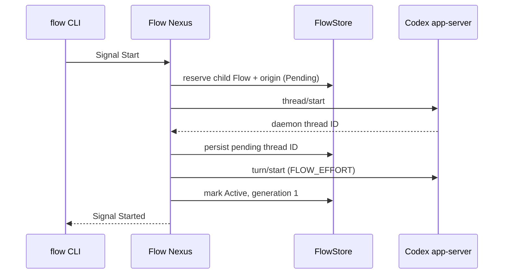

# Flow Nexus design

The ordinary and meta sockets are separate Signal edges. Text ends at a CLI:
the client turns one inline Datom into a typed request, sends an rkyv frame,
and textualizes the typed reply as Datom. The standalone `signal-flow` repo
owns `Start`, `Restart`, `ResolveRecipient`, `Stop`, `List`,
`Replace`, `LaunchStatus`, `Observe`, and `ResolveCaller`;
`meta-signal-flow` owns `Configure`, `ConsumeReset`, `Retire`, and the pane
writes `Deliver`, `Vet`, `Command`, with `ResolvePeer`. Each contract versions
its own wire.
`RunningNexus` dispatches; `FlowStore` owns working state and policy.

What the Nexus does is its Operation root, `crates/flow-nexus/ethos/operation.ethos`,
generated by ethos-zero 16.0.0 into `src/generated/operation.rs` and held fresh by
the crate's build script. Every effect of the launch, stop, retire and record
paths (composing a launch, reserving it, each journal and lifecycle record,
registering, confirming, opening the pane, spawning and binding the harness,
titling, submitting the first prompt, closing a pane,
pruning a bundle copy) is one `Operation`, performed through `Performs` on
`RunningNexus` and answered by one `Outcome`. The dispatch paths decide; only
`perform` acts. Reads of the world (pane presence, transcript receipts, skill
catalogs) are not operations, and delivery's own lease and delivery records
are not yet.

Every harness event reaches Flow through the harness's hooks calling the Flow
CLI. `flow-hook`, which Flow writes into each Claude flow's launch settings on
SessionStart, PostToolUse and Stop, sends `Report.{ FlowId Event }` with the
`FLOW_ID` from its environment; the Nexus performs it as `Record.Harness`,
appending the event to that flow's events in its Memory, and answers
`Reported`, or `Refused.UnknownFlow` for a flow it does not hold, which it
never adopts. The owner reads a flow's events with meta `ReadEvents`.

A Claude flow's FlowId exists before its harness. Reserve chooses the Claude
session id from the launch request id (UUIDv5-shaped, so one request names
one session), claims the FlowId for it through `flow-id`, and holds the flow
in Memory (its empty events row). Spawn types `export FLOW_ID=<FlowId>` into
the pane after unsetting the inherited identity and starts Claude with
`--session-id` set to that session, so the harness and every hook it runs
carry the FlowId from `SessionStart` on, and that first `Started` lands
before Register. Bind verifies the harness came up as that session and the
claim names that FlowId. Every Claude launch pane also gets `export
FLOW_SOCKET=<path>`, the ordinary socket this Nexus serves as its store
configures it, so the hook's `flow` reports to the Nexus that launched the
flow, not to the default socket under the pane's runtime directory. A Codex
launch reserves nothing: its session is
named by its app server, and Bind claims from it as before.

A launch names the Address of its seat in its profile. The write that
journals the registration acknowledgement, once the seat's native binding is
witnessed and its flow registered and before its first prompt is typed,
records that metaflow Awake as the flow and holds it: an Address hold row
keeps the metaflow as the launch found it. Confirm makes the flow Active and
drops the hold in one write, the Address staying taken. A launch settled as
refused, or a flow recorded Stopped, Retired or Exited, while it holds its
Address gives it back in that write: a metaflow still Awake as the flow
returns to what the hold kept, keeping its queue; one the launch created is
removed, or left Asleep when requests were queued meanwhile. A seat that holds its Address neither sleeps nor drains at a
Stop. The taking follows Bind's rules: a metaflow Awake as a live flow, or
bound to a live process, is refused, an Ended one is refused, and an absent
or Asleep one, or one Awake as a flow no longer live, is taken, a displaced
flow joining Past; a replacement takes over its predecessor's. Start refuses
before launching an Address it could not take or another unsettled launch
names. A resumed wake takes its Address through the same rule with
`Record.Awoken`. `Identify` names a process in a launched flow's pane, found
from the Herdr marks as ResolveCaller finds it, as the Address that flow is
Awake at, so a launched seat sends through Message; a process bound by Bind,
or descended from one, keeps naming that binding first.

The launch brief and the Codex thread environment give the child its allocated
`FLOW_ID` and `FLOW_DIRECTORY`, then record the origin the Nexus derived from
the calling process: the flow bound in its pane and that flow's session, or
Unbound. Origin does not grant authority to launch. A restart is authorized
only when the calling process's derived origin is the target's registered
identity, its Flow ID and harness session. The store returns that child’s saved daemon
thread ID; the adapter resumes it; generation changes only after the resume
turn succeeds.

If `thread/start` succeeds but the first turn fails, a durable Pending record
keeps the known thread. A later child-self restart resumes it rather than
launching a second thread. A thread-start failure leaves a non-resumable
pending reservation. Both conditions recover from `FLOW_NEXUS_STORE`.

`ResolveRecipient` projects a durable Flow record into a `FlowNode`: Flow ID,
daemon session ID, harness kind, route readiness, endpoint, origin, and
lifecycle. Message Nexus consumes that typed reply instead of maintaining a
second identity registry.

`ResolveCaller` names the flow that is calling. The Nexus reads the peer
process of the ordinary connection from the kernel (`SO_PEERCRED`); nothing in
the request names the caller. Herdr's snapshot carries no process IDs, so the
pane is read where Herdr marks it: every process Herdr starts in a pane
inherits `HERDR_PANE_ID`, and in a named session also `HERDR_SESSION`, and
the Nexus reads them from the peer's `/proc/<pid>/environ`, or from its
nearest ancestor's when the peer's environment was scrubbed. Herdr's default
session exports no `HERDR_SESSION`; for a pane ID alone the Nexus walks on to
the Herdr server, the ancestor whose `/proc/<pid>/exe` is the Herdr binary,
and takes the one session whose socket in `herdr session list --json` that
server listens on, as the kernel lists its listening Unix sockets. A server
on the sockets of more than one session, a pane ID that changes on the way
up, or no Herdr server names no pane. The registry must hold exactly one routable
flow on that session and pane, and the live snapshot must still show its
binding (pane, terminal, harness); otherwise the reply is `CallerUnknown`.
The answer is the flow's role, `Caller.{ FlowId FlowAspect PowerLevel
ModelName }`, kept as its own record when MetaBindExisting binds a flow or a
Start registers one. The optional FlowId in the request is the caller's claim:
a different one is refused as `CallerMismatch`, which carries the true Caller.
A store written before roles were kept adopts them when it opens, from the
binding launch's profile or from the flow type MetaBindExisting wrote. A
MetaBindExisting of a flow already held records its role only when the stored
flow is that binding (thread, harness, Herdr session, pane and terminal) and
has no other role; it writes nothing else, and any other binding is refused as
`DuplicateFlowId`. The Codex endpoint of an imported flow is a separate fact,
never a gate: routing and promotion follow the Herdr route. `ResolvePeer`
on the meta socket answers the same question for a process Message names.

Flow is the only pane writer. `Deliver`, `Command` and the work handed to a
woken seat act only on a route that still matches the native Herdr
snapshot, and each holds the pane's lease (`delivery::lease`) from its first
key to its last. A route is keyed on what Herdr binds for the pane's life:
session, pane id and terminal id, with the harness kind. The agent name is a
label a running flow may change; it is re-read from the snapshot and
reported, never matched. `Deliver` renders the typed Message (its Priority
head first), refuses a body carrying a control character or a harness command
(`delivery::body`), refuses a Blocked recipient and an occupied composer, and
for `Soft` a recipient that is not Idle or Done. `HardAbrupt` presses the
profile's interrupt keys when the recipient is Working and records whether it
was seen leaving Working. Grades are exact: `NotDelivered` (nothing typed),
`Transported` (Herdr took the text for the exact binding), `Presented` (a
settled agent observed reacting on the exact pane, the route still matching
afterward) and `Uncertain` (typed, reaction unobserved). Each step is written
to a `PaneLease` row; a row found when the store opens settles `Uncertain`
and is never retried, and `Deliver` repeats answer the stored `Delivery`. A
Pending row is promoted only by a Presented Deliver; no probe or marker is
ever typed to promote it. Stop changes the durable lifecycle only after the
exact pane closes successfully, and closes under the lease. `List` reads the
same store rows and sorts them by Flow ID.

The meta socket answers `MetaRefused` unless its peer (read from the kernel)
is the configured Message Nexus executable, a process in no flow's pane (the
owner), or a flow whose aspect is in `MetaAspects` (default `[ Psyche ]`).
Both sockets are `0600` under one UID, so this stops accidents, not an
adversary.

`Replace` carries a `StartRequest` whose profile names the predecessor. The
successor launches through the one Start path; on `Started` the predecessor is
recorded `Stopped` (so `ResolveRecipient` and `Deliver` refuse it), then its
exact pane is closed, and only the `Replaced` outcome releases the successor
to routing. Until then the successor is held: `ResolveRecipient` answers
`FlowUnavailable` and `Deliver` answers `RouteUnavailable`. A predecessor whose
pane a readable Herdr snapshot shows absent is already reaped: it is recorded
`Stopped`, nothing is closed, and `Replaced` releases the successor. When Herdr
cannot be read, or shows the pane under another binding, the pane may still be
open: that is `ReplaceRejected.ReapRefused.RouteUnavailable`, nothing is
closed, and the successor stays held. A close that fails on a pane that exists
is `ReplaceRejected.ReapRefused.CloseRefused`. Either refusal leaves neither
flow routable, and a repeated `Replace` of the same request takes the reap up
again.

Every launch request settles into one stored outcome — `Started`, `Replaced`,
`StartRejected`, or `ReplaceRejected` — once an attempt was reserved for it.
`LaunchStatus` answers a known request with one `LaunchInspected`: its durable
attempt, optional settled outcome, and current recorded `FlowNode` or explicit
absence. A request with neither attempt nor outcome is unknown; an outcome
without its attempt or a binding that disagrees with the outcome is
`InconsistentRecords`. The reads compare each database marker and recheck the
current marker; a changed view is `ReadViewChanged`. This is a checked
multi-read, not a storage transaction. A duplicate `Start` may still answer
`LaunchPending` while the original launch runs. `Observe.Launch` keeps its
connection as the subscription: the current inspection on open, one
`LaunchInspected` frame per phase change, and the settled inspection last,
then the Nexus closes the exchange. Phase changes are announced by the store; a launch
waiting on its first prompt is moved by a file-change watch on its native
transcript root, which promotes it under the dispatch gate. The Nexus holds
that watch itself for every ambiguous launch, from startup on, so a receipt
that lands after `StartAmbiguous` promotes with no subscriber and no second
Start. Nothing re-reads on a timer.

A plain `Start` does not answer the caller with that ambiguity while the
launch is in fact settling: having submitted the first prompt it releases the
dispatch gate and waits for the launch's outcome, which the same watch
produces, and answers it. `StartAmbiguous` is what a seat that never answers
at all comes to, once the wait's bound has passed.

The first prompt is the brief, and the seat's first answer performs it. The
receipt is what the native transcript of the bound
session shows: the first turn authenticated by its body digest, every selected
skill loaded in order, and, for Claude, the seat's first answer after them at
the intended model and effort. Codex records its turn's model and effort
before its input, so its confirmed skill loads are the receipt. No caller and
no human follows a launch.

`List` answers the reconciled truth, not the stored row alone: a live flow's
bound pane is looked for in Herdr, and finding it present reports the flow
Active with a refreshed route, while finding it gone reports it `Exited`, with
no route. A Herdr that cannot be read changes nothing.

Reading that truth and recording it are separate. `List` writes nothing,
because a query does not change what it is asked about; an ended lifecycle is
persisted only by a command that witnesses a pane's fate — `Stop` and a
replacement's reap record `Stopped`, a `Deliver` whose bound pane is gone records
`Exited`, and `Retire` on the meta socket records `Retired`.

Each ended state names who ended the flow, and they do not stand in for one
another. `Stopped` is Flow's own act on a pane it held. `Exited` is the seat's
own going, or its accident. `Retired` is an owner's act, and only authority
produces it: a pane going away never retires a flow, because an exit retains
the flow's record and retirement is a decision, not an inference. None of the
three deletes anything.

Every Codex thread Flow opens declares one dynamic tool, `send`, whose
arguments are a target Address, a kind (`Order`, `Question`, `Result`,
`Notice`) and a body. The living's words are not among the kinds: Flow admits
a Lock and a Deliver from the bound Message process alone, so no route through
Flow lets a flow send `Psyche` or `Psyches`. The app-server accepts a
thread's dynamic tools only on a connection initialized with its experimental
API. Before Flow opens such a connection it probes the deployed app-server: on
a connection initialized without it, a `thread/start` declaring the tool must
be refused for exactly that reason (codex 0.161.0-alpha.2 answers -32600,
"thread/start.dynamicTools requires experimentalApi capability") before any
thread exists. Any other answer is `SendToolUnsupported`; a thread the probe
started is archived at once on the same connection. The launch is refused
at its Codex thread stage (`NativeLaunchRefused.{ CodexThread
SendToolUnsupported }`) rather than started without the tool.

The app-server sends each call as an `item/tool/call` server request to every
connection subscribed to the thread, and takes the first answer. A call left
pending while no answer came is replayed to the next connection that resumes
the thread. The Nexus keeps one connection per live Codex thread it holds,
subscribed by `thread/resume` (without its turns) when the Nexus starts, when
the store announces a change that brings the thread's flow, and after every
reconnect. That connection starts no turn and carries no model content, and it
is the one intended responder. First answer wins is how the app-server
behaves, not a security guarantee: any process of the same user that resumes
the thread can answer a call first.

A launch's first turn can call the tool before its flow exists. Herdr's
`agent start` returns only once the agent is idle or done and interactively
ready, and a turn waiting on a call is neither. So a Codex launch, after
`thread/start` and before `turn/start`, records the thread as its own
(`flow_nexus_launch_opened_threads`); no first turn is started when that
fails, and the thread is archived. The connection that started the thread is
subscribed to its server requests from then on (a `thread/resume` of a
thread with no turn yet is refused, "no rollout found"), so it is kept open
as the launch's responder. While the launch waits for Herdr's start and for
the bind's rest wait, holding the dispatch gate, it reads that connection and
answers each call as the gate's holder. The connection is closed when the launch ends,
whatever it came to; a later call is the Nexus's responders'. Targets the
launch's calls queued work for are woken once the gate is given back.

A Codex launch a Nexus left between opening its thread and acknowledging its
seat is never finished, and its registration would wait on a seat that a
pending call keeps from resting. Before serving anything, the Nexus takes
each unsettled Codex launch whose thread is recorded and whose phase is
NativeLaunchIntentRecorded or NativeBound. Its outcome and its cleanup are
apart: the Nexus first records the launch's cleanup, a thread step and a
pane step both Pending, then settles the launch
`NativeLaunchRefused.{ Spawn Unclassified }`. The thread step resumes the
thread and answers each replayed call: one the earlier Nexus committed is
answered from its record and queues nothing more, any other is refused
`ThreadUnowned` and queues nothing; then it archives the thread, and is Done
only once the archive succeeded. The pane step takes down its pane and any
flow it registered, and is Done only once nothing of it is left running. A
step still Pending is taken again at every start, the launch already
settled.

A pane is closed only when Herdr shows it the Flow's own: the agent at the
recorded pane and terminal, of the recorded harness, reports the recorded
native session, or, a Codex agent reporting none, one of the pane's
foreground processes runs `resume <thread>` for the recorded thread; or the
pane shows no agent at all. A pane running another session, a session
nothing proves, or a Flow with no recorded session closes nothing, and a
launch's pane left so stays recorded for the next reconciliation.

A call is handled under the dispatch gate. Its sender is read from Flow's
records each time it is handled, a replayed call included: the one live flow
Flow holds on the calling thread, and the metaflow Awake as it; failing that,
while the Codex launch that opened the thread is unsettled and no other flow
or launch holds its Address, that launch's Address. A thread no flow of
Flow's runs and no unsettled launch opened is `ThreadUnowned`, a Stopped, Retired or Exited flow is
`FlowEnded`, and a flow whose metaflow is no longer Awake as it (Asleep, or
moved on by a Refresh or a fresh wake) is `NotAwake`; none is recorded. The
request is queued for the target, with that sender, under the rules a Lock and a Deliver follow
(an absent target is `UnknownRecipient`, an Ended one `RecipientEnded`, one
Message holds an unexpired lock on is `Held`), and the call is
recorded with its outcome in the commit that queues it, in
`flow_nexus_send_calls`, keyed by thread, turn and call id with the digest of
its tool and arguments. A call whose key is recorded with the same digest is
answered from its record and queued nothing more; with another digest it is
`KeyReused`. The answer is one `inputText` item holding the outcome as a
datom, `Queued.{ Sender Target }` or `Refused.SendRefusal`, with `success`
true only when queued.

Whether a target wakes is read from Flow's records, never carried with the
answer. A metaflow is due a wake when it is Asleep, its layer is not Primary,
and it holds an Order, a Question or the living's words, or its last flow is
still live. After every commit that queues a request, from a send-tool call
or a Deliver, and after a replayed call is answered from its record, the
target is held against a second wake, read again under the dispatch gate,
and woken when due; this runs whether or not the answer reached the caller.
At its start the Nexus wakes every metaflow due a wake, so a Nexus that died
between the commit and the wake leaves none owed. A wake already running for
the metaflow absorbs the request: it drains what arrives during it.

Every queued request carries who sent it, `QueuedRequest.{ SentBy Request }`:
the Sender a Deliver's Lock named (which the bound Message peer asserts) or
the metaflow a send-tool call is attributed to. A request queued before Flow
kept senders reads `Unknown`; no address is supplied for it. A woken or
drained flow reads each queued request as its datom, sender first:
`{ Sender.{ Mind flow Tertiary } Order.«Run the tier tests.» }`.

This establishes which metaflow a call is attributed to, from Flow's records
of the thread. It does not authenticate a human or a process as the call's
initiator: a call carries no initiator identity, and any process of the same
user can start a turn on any thread through the app-server socket, so it can
start turns whose calls Flow attributes to that thread's metaflow.

`RegisterFlow` is a meta Signal for importing sessions created before Flow
Nexus. It preserves the same `FlowNode` shape used by resolution, so imported
and Nexus-launched identities share one registry and one read contract.
For Claude records, the stored endpoint is only a candidate: every resolution
revalidates the full session against `state.json`, the daemon roster,
rendezvous and control sockets, process liveness, permission fields, and
terminal lifecycle states before returning `Ready`.

Fresh stores persist default sockets, source root, and Codex endpoints. Meta
`Configure` declares one configuration family whole (`Nexus`, `Models`,
`Thresholds`, `LeaveOuts`), replaces the committed family in one commit, and
answers `Configured.Replaced` or `Configured.Unchanged`; rebinding live
sockets and adapters is deferred to a Nexus restart. No environment variable is laid over the stored values;
`Configure` is their only way in. The adapter is outside the Signal wire boundary: the
Codex app-server conversation is WebSocket/JSON-RPC through the configured
control socket. `ConsumeReset` uses the same adapter but is reachable only
through the meta socket. Both sockets are owner-only (`0600`); this separates
administrative protocol surface from the ordinary surface inside one Unix
account and does not distinguish processes with the same UID. Reset callers
supply the idempotency key so retries reuse it. Protocol tests cover framing, refusal, timeout,
assigned-flow context, and the reset outcome mapping.
